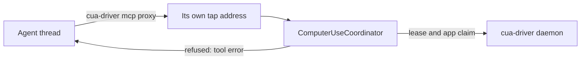
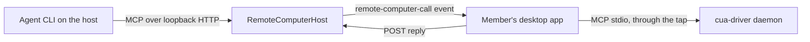

# Computer Use and remote desktop

## Computer Use

Computer Use is `cua-driver`, a third-party MIT binary, and OpenBot owns how it runs.
`cua-driver-runtime.ts` in the main process starts one long-lived `serve` daemon and holds it; each
provider CLI spawns its own short-lived `cua-driver mcp --socket` proxy against that daemon. All
screen capture, accessibility reads, and input posting happen inside the daemon, so the proxy's own
identity does not matter.

The daemon is spawned directly, and never through `open(1)` or `NSWorkspace`. macOS finds the
responsible process by walking up the launch chain, so a direct spawn puts OpenBot at the top of it
and the user grants Screen Recording and Accessibility to OpenBot rather than to somebody else's
helper. `CUA_DRIVER_EMBEDDED=1` tells the driver to stay on that path instead of relaunching itself
as its own application. Anything that launches the daemon another way breaks the attribution, which
is the reason the earlier Codex helper was replaced.

Startup calls `warmUp()`, which reads the state once and keeps the daemon only when both grants are
there. A user who granted them keeps the tools after a restart, and a remote request or a scheduled
task — neither of which opens a window — reaches them too. A user who granted nothing keeps no
process, and no prompt is raised either way: only using the driver asks for a grant. Every other
start is lazy, on a state read from the panel.

The control socket lives in the private per-user runtime directory, mode `0o700`, not in `/tmp`:
whoever reaches it can drive the whole desktop. It cannot live under `userData`, because
`sockaddr_un.sun_path` holds 104 bytes on macOS and an isolated development profile spends most of
them on the worktree hash. Windows uses a named pipe, which has no such limit; its name is random,
because Windows lets a second process add an instance to a name it can guess, and it is kept in the
profile so that it is random once rather than once per launch. The endpoint has to hold still: it
reaches each proxy as an argument, and the arguments are folded into the stored Codex tool
fingerprint, so a name that moves at each launch replaces every session after a restart. The command
has to hold still for the same reason: the packaged Linux build is an AppImage, whose resources are
mounted somewhere else at each launch, so there the proxies are given a link below the profile that
the runtime points at this run's driver.

One MCP entry reaches every provider. `CuaDriverRuntime.mcpServerConfig()` returns a config only
while the daemon runs, and `AgentService.enabledMcpServers()` appends it, which is the one function
Codex, Claude, and ACP all read. Two properties keep it there: the name is not in
`RESERVED_MCP_SERVER_NAMES`, which is a drop filter rather than a marker, and `workingDirectory`
stays empty, because ACP has no field for one, so an entry with one would vanish for ACP providers
with no error. Codex staleness needs no separate signal, because
`toolFingerprint` already folds the MCP entries and a changed fingerprint forces a replacement
session. `onMcpServerChanged` is what refreshes the agent runtimes, which deactivates every
stored provider session: the next turn starts a new one, which keeps the public thread and loses
what the provider held privately. So it reports two moments only — the entry appearing on a start a
user asked for, and the daemon dying under OpenBot. It is quiet for a grant given while the daemon
serves, which changes the state and not the tool set; for the startup warm-up, which settles the
entry the stored sessions already had; and for the stop at teardown, which happens at order 55,
before the agent service at 110, and would otherwise deactivate on every quit the sessions the next
run is meant to resume.

`capabilities.computerUse` is pushed by main from the daemon's own permission answer. It is no
longer probed from Codex `plugin/list`, which is why the capability now reports the same state for
every provider.

The driver is packaged, not downloaded on demand, so it is pinned in `native-runtime.lock.json` like
the other native runtimes rather than managed like a provider CLI. The pinned file list is an
allowlist: `scripts/install-cua-driver.ts` copies only the named paths and checks each digest, so an
upstream layout change fails the build instead of shipping a surprise file. Each installer carries
only its own target. On macOS `mac.signIgnore` keeps the vendor's Developer ID signature, because
re-signing under OpenBot's inherited entitlements would drop the Automation entitlement the driver
needs. A packaged build reads the copy under `resources/cua-driver` and nothing else, because the release
is pinned and signed against that build and an environment variable must not decide which program
drives the user's desktop; a release without the binary reports no driver. In a checkout
`resolveCuaDriver` also reads an override, an install directory and `PATH`, so a developer can point
`OPENBOT_CUA_DRIVER_PATH` at another build.

### Turns between agents and threads

Every agent with Computer Use on, and every thread of it (its own chat, each task and each routine
thread), can use the desktop. They share one screen, one keyboard and one pointer, and the daemon
takes no turns: two conversations that type at the same time can send keys into each other's
window. So OpenBot takes the turns, in the tap, before a request reaches the daemon. The design is
borrowed from agent-desktop: each actor has a stable id and its own cursor, and actions take turns
on one interaction lease.

- **One address for each conversation.** `McpServerSource` takes an audience: the agent and the
  public thread. `ThreadLifecycle` passes it for Codex, and sends `openbotThreadId` beside
  `openbotAgentId` to Claude, ACP, Pi and Muse, which read the servers themselves; ACP keeps it on a
  released session, so a reopen gets the same address. Only a conversation with Computer Use on has
  an audience, so no address is made for one that gets no entry. The gateway asks
  main for the Computer Use entry of that audience, and the runtime gives its proxy the socket
  `a-<key>.sock` beside the shared tap socket (a pipe name with the key on Windows). The key is the
  first 16 hex digits of a SHA-256 of the agent and thread ids, so it is the same in every run: the
  arguments are in the Codex tool fingerprint. Each Codex session is replaced once after the update
  that brings this. The tap binds the socket before the entry is returned, because binding is
  synchronous in Node, and binds every one again when the daemon restarts. A start removes the
  sockets that a crashed run left. A reader that names no conversation, such as the permission panel,
  gets the shared address and is one actor. The remote client of `remote-computer-use-v1` is one
  more actor, because the released protocol names no agent.
- **Who sent a request.** The proxy opens one connection for each request, so a connection is one
  request and its actor is the address it came in on. The address is not authentication: every agent
  runs as the same user and can reach every socket. The turns keep honest agents apart.
- **The action lease.** A tool that sends input (`click`, `type_text`, `hotkey`, `drag`,
  `launch_app`, the `browser_*` and `page` actions, a tool that a later driver adds) takes the one
  lease before the tap forwards it, and gives it back when the daemon's answer line ends or the
  connection closes. Waiters are served first in, first out. A request waits at most 30 seconds for
  the lease and then gets a tool error. An action holds the lease at most 30 seconds, so a daemon that
  does not answer cannot stop every agent. Reads (`get_window_state`, `list_windows`, screenshots,
  `zoom`) and the driver's own session, cursor and settings tools take no lease.
- **The app claim.** The first actor that sends input to an application (the `pid` of the request)
  holds a claim on it. A click or scroll from another actor there waits up to 15 seconds for the
  claim to end, then gets the tool error "<app> is in use by <agent> (<thread>). Try again later or
  use another app." A request that takes keyboard focus (`type_text`, `press_key`, `hotkey`,
  `set_value`, `bring_to_front`) gets the same error at once. A claim ends when the holder's turn
  ends (`turn-completed`, a stopped or failed turn included), and after 60 seconds with no action
  from the holder. `AgentService` reports the turns of every thread through `observeTurn`, before
  the tasks, channels and messaging threads take their own events, which the `event` listeners never
  see. The app name comes from the daemon's `list_windows`; the agent name and the
  thread title come from the agent service. The text is `error.computerUse.appInUse`, sent with
  `sourceText`. The refusal has no `structuredContent`, because a client checks that against the
  tool's output schema.
- **The cursors.** The tap keeps the last point of each actor. The overlay draws one dart for each
  actor whose last point is at most 15 seconds old, in the agent's avatar colour, with the agent's
  name beside it. The rim still follows the last action of any actor.

The tap forwards each line unchanged and does not change an answer, except for the JSON copy of
`structuredContent` described above. `scripts/computer-use-coordination-e2e.ts` runs the tap and the
coordinator against a stand-in daemon at its socket and checks the order, the refusals and the
releases.

### The agent cursor

OpenBot draws the agent cursor in its own per-display overlays for every display layout. The
runtime starts `serve` with `--no-overlay`. The driver's overlay covers only the main display and
cannot follow a display connected after startup. Keeping cursor ownership in OpenBot lets the
highlight controller add, resize, and remove display overlays without restarting the daemon or
changing provider sessions.

### Agent display on a server

A self-hosted server and the container start two Xvfb displays, and name the agent display in
`OPENBOT_AGENT_DISPLAY`. A boat hosted server names its desktop `:0`, and OpenBot runs on an Xvfb
display. Electron keeps its own `DISPLAY`: the built-in browser draws its tabs in
the OpenBot window, and under Xvfb a hidden view gives no capture and no clicks, so OpenBot cannot
only hide its window. On Linux, `agent-display.ts` sets `DISPLAY` to the agent display for the
driver daemon, for Sunshine, and in `agentEnvironment` for every agent process. The driver and
Sunshine open the display that `DISPLAY` names, so a screenshot, an input event and the remote
desktop stream all use the agent display, and a program that an agent starts opens there. The
per-display overlays are OpenBot windows, so with an agent display they are not started: nothing
draws the agent cursor or the rim there. `capture_screen` and `list_capture_sources` use Electron's
`desktopCapturer`, which sees only the OpenBot display, so with an agent display they are not
available, and agents take screenshots with the driver.

`openbot.service` holds the Xvfb displays too, and a stop signals each process of the unit at the
same time. An Xvfb that stops first ends OpenBot before it closes its database. So the unit's
`ExecStop` runs `openbot-hosted-server --stop`: it sends `SIGTERM` to OpenBot only, whose PID the
script writes to `$XDG_RUNTIME_DIR/openbot.pid`, and waits for it. The container does not need this:
tini signals only OpenBot.

Because the driver draws no cursor, its motion styles do not apply. The renderer plays the driver's
`adaptive` style itself (`agent-cursor-motion.ts`, a port of the driver's `trajectory.rs`): a Fitts
min-jerk glide, or a wide swoop for a move over 900 points. The tap does not delay a request, so the
cursor shows where an action went, from 180 ms to about 1.1 s after the driver acts.

Every copy OpenBot starts gets `CUA_DRIVER_RS_TELEMETRY_ENABLED=0` and
`CUA_DRIVER_RS_UPDATE_CHECK=0`. OpenBot ships the driver, so its vendor analytics are not something
a user chose, and OpenBot pins the version, so a release check could only offer an update OpenBot
would refuse.

### A member's own computer, for agents on a server

`remote-computer-use-v1` lets an agent on a server use Computer Use on the computer of the member who
owns that agent. The member turns it on in that computer's desktop app, per joined server, under
Settings > Computer Use. The switch is stored in `servers.json` of that computer
(`remoteComputerServerIds`) and starts off; leaving the server turns it off.

- **Desktop app** (`RemoteComputerClient`). Its driver connection has an address of its own, so its
  calls take turns with the local agents as one actor named "another agent (a joined server)". While the switch is on, the server is connected, the host
  advertises the capability and the local driver is `ready`, it posts `state` with `available: true`
  and the computer name, and repeats it every 30 seconds. Each `remote-computer-call` runs on one MCP
  connection of its own to the driver (a `cua-driver mcp` child through the tap), so OpenBot draws its
  agent cursor and rim for it as for a local turn. A call from a server whose switch is off is
  refused here as well. Tools that change the driver itself (settings, updates, extensions,
  recordings) are not offered. A screenshot gets `max_image_dimension` 1568 unless the agent names a
  size; the driver maps the coordinates back. An answer that is still over the reply limit is sent
  again as JPEG at the same size. The window shows "An agent on <server> is using this computer" with
  Stop, and a system notification says so when a server starts; Stop turns the switch off and aborts
  the running calls.
- **Host** (`RemoteComputerHost`). A computer is one session: the `state` route keys it by the
  session of the request, and a call goes only to the event connections of that session that took
  the capability. A reply settles a call only from the same member and session. The host offers the
  computer only on a server where that member is the only enabled member, to every agent the member
  manages. Agent access levels are not enough: another member could reach the computer by a message
  from one of their own agents, through a channel, or by reading a bearer from a provider process,
  because every agent on a host runs as the same operating system user. A computer that no agent may
  use is not kept. For each pair of computer and agent,
  `mcpServers()` returns one http entry, named `my_computer` (`_2` and up for a second computer of
  the member), whose path and bearer (an HMAC of a per-run secret) name the computer and the agent.
  Each request checks the bearer, that the computer is still there, and that the agent may still use
  it. `agentMcpServers` keeps for an agent only the entries made for it, and none for a hand-off that
  names no agent. A computer that sends no `state` for 90 seconds is forgotten. The last event socket
  of the session closing fails its waiting calls at once. A change in the entries refreshes the agent
  runtimes, like the local driver entry; a repeated state or a new computer name does not. The host
  refuses a tool request longer than the event allows (a 128-character name, 64 KiB of arguments),
  because the app would treat it as a malformed event and drop its connection.
  A call that the provider cancels, or whose request closes, stops waiting and frees its slot; the
  computer may still finish an action it already started, and its late answer is dropped. A bearer
  whose computer is gone gets an empty tool list and a tool error rather than 401, which an MCP
  client could take as a sign-in to start. The app answers every call, a failure included, and
  measures the answer in UTF-8 bytes against the 1 MiB body of an HTTPS host.

Anyone who controls the host can reach the computer while the switch is on, and so can text that
reaches the member's own agents, such as a linked chat or a webhook, as with local Computer Use. The
setting says so. The answer of a call travels to the host and, as a tool result, to that agent's
provider. The app refuses tools that change the driver itself by name; the boundary is the switch.

## Remote desktop permission checks and live tests

`RemoteScreenGateway` owns setup checks and live-test session ownership. The optional
`remote-desktop-setup` Team API capability uses separate v4 adapter routes; released codecs remain unchanged.
Diagnostics contain host/account names and permission results and travel only to an authenticated member.
They do not include Sunshine credentials or screen content. The renderer opens macOS settings only through
fixed local IPC actions.

Sunshine checks its own macOS permissions and hosts the temporary native test panel. During a test, native
input is restricted to that panel and tagged for the test. The panel requires both the test tag and the
Sunshine process ID before recording a click or keyboard result. The gateway rejects additional sessions
and display switches during a test and closes the panel when its owning stream disconnects. It does not
interrupt another member's session to start a test.

Local tests use a temporary HTTP listener bound to `127.0.0.1`, without publishing the host or requiring an account. The same single-use viewer grant and cookie checks protect it. The gateway owns the listener and closes it with the test session; its lease expires after three minutes. Local test IPC can address only sessions created for this purpose.

A local video-only test can run without native diagnostics. Its viewer iframe is inert and excluded from keyboard focus; it does not start a native input test or report input success. Local loopback test cookies use HttpOnly, Secure and SameSite=None so the embedded viewer works across the app origin.

A paste in the viewer puts the member's text on the host's clipboard, and then presses the host's
paste keys. Moonlight sends Cmd+V or Ctrl+V as keys and cancels them, so the browser fires no paste
event and the host pastes its own clipboard. The gateway adds `openbot-paste.js` to Moonlight's
`stream.html`. The script keeps the member's paste key from Moonlight, reads the paste event, and
posts the text to `moonlight/openbot-clipboard`. Both routes are under `moonlight/` because the
released Team API adapters forward only that family of viewer routes. The same viewer cookie or
WebRTC session check protects them, and the clipboard route refuses a request from another site.
At the paste event, the script presses the host's paste modifier, Cmd for a macOS host or Ctrl for
other hosts, and releases the member's other held modifiers except Shift. A Win or Super key
released with no key between would open the host's Start menu or Activities. After the upload, the
script presses V. Text that the host
already has from an earlier paste is not sent again, so a copy made on the host stays on its
clipboard. A host with no clipboard writer serves neither route.

On Linux, the gateway accepts only an X11 session (`DISPLAY` set, no `WAYLAND_DISPLAY`, and
`XDG_SESSION_TYPE` not `wayland`). Sunshine then runs with X11 capture and software encoding, and
sends input through XTest, so a hosted server under Xvfb needs no uinput device and no extra
capability. On a server with an agent display, Sunshine runs on that display (see
[Agent display on a server](#agent-display-on-a-server)). Linux has no permission checks: an X11 session is ready.

### Codex tool approvals

Codex saves an “Always allow” tool decision only when the MCP server is in a file-backed
configuration layer. A thread configuration alone does not satisfy this check. Before starting or
resuming a thread with Computer Use, OpenBot registers `computer_use` in the Codex user
configuration through `config/batchWrite`. The new entry contains only a placeholder command
(`openbot-mcp`) and `enabled = false`. The write uses the user layer's version, and an existing entry is left unchanged.
OpenBot does not save the driver socket, environment, or credentials in that entry.

The thread configuration enables the running driver and supplies its current command, arguments,
and environment. It also carries the saved per-tool settings, including `set_value.approval_mode`.
Saved tool settings are also in the session fingerprint. When an approval changes, the next turn
replaces a loaded provider session that holds the old policy.
An agent with Full access does not ask: OpenBot accepts each Computer Use tool consent once and
saves nothing, as it does for other MCP tools. A Workspace only or Ask first agent shows the card,
and Codex keeps "Always allow" per tool and per provider account.
When Computer Use is off for the agent or the driver is unavailable, the thread keeps the saved
entry disabled. A registration failure stops the thread with steps to repair the configuration or
turn off Computer Use. The application-access questions from the driver still use their existing
approval flow.
